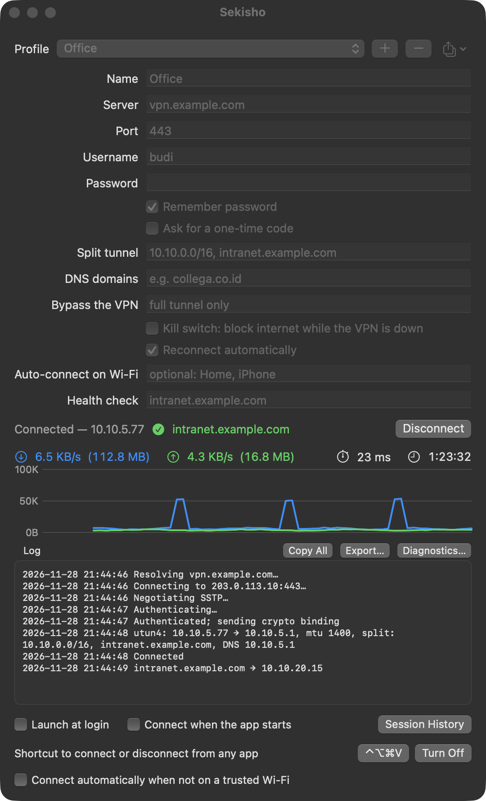
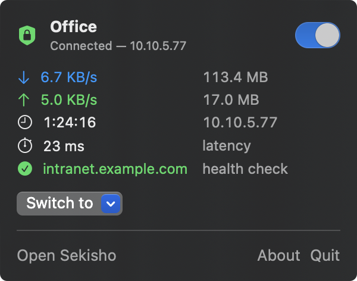
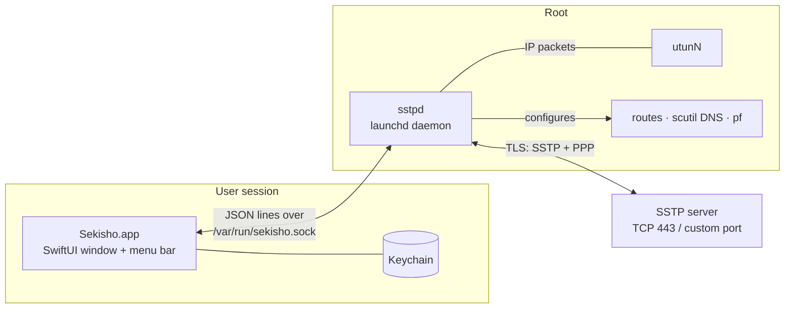
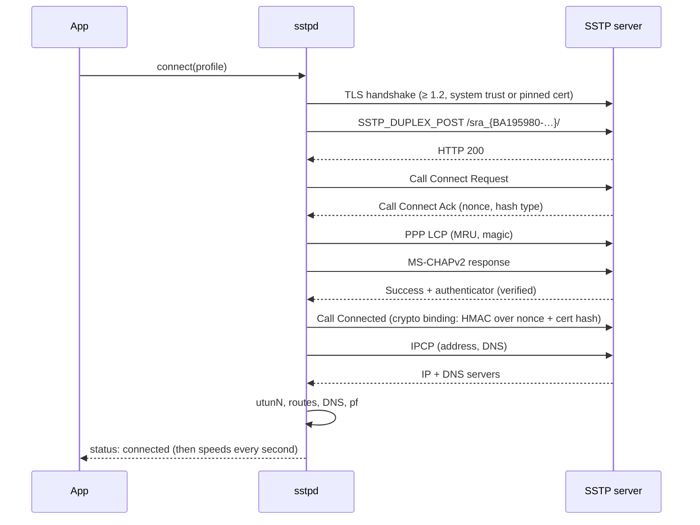
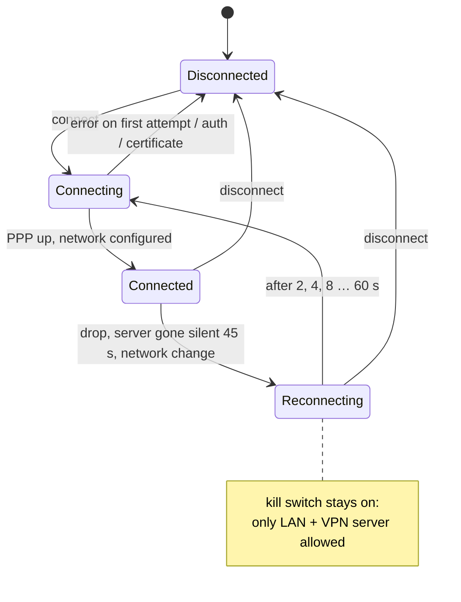

<p align="center">
  
</p>

<h1 align="center">Sekisho (関所)</h1>

<p align="center"><b>SSTP VPN client for macOS</b> · by <a href="https://hiiruki.moe">Hiiruki</a></p>

A *sekisho* was a checkpoint gate on the old Japanese highways: you passed only with the right papers. Sekisho is a
native SSTP VPN client for macOS 13+ on Apple silicon and Intel: a SwiftUI window and menu bar app, plus a small root helper (`sstpd`) that
creates the tunnel with a plain `utun` interface. No NetworkExtension, no paid developer account, no Xcode:
Command Line Tools and Swift Package Manager are enough.

<p align="center">
  
  &nbsp;&nbsp;
  
</p>
<p align="center"><sub>Sample data: <code>vpn.example.com</code> in split tunnel, with a health check on an internal host.</sub></p>

| | |
|---|---|
| Bundle ID | `moe.hiiruki.sekisho` |
| Helper | `moe.hiiruki.sekisho.helper` (launchd, root) |
| Version | From git (`scripts/build-app.sh`): `1.3.0` exactly at the `v1.3.0` tag, `1.3.0-2-gabc1234` for commits after it, `-dirty` with uncommitted changes; build number = commit count |
| Icon | drawn by `scripts/make-art.swift` in the macOS 27 Liquid Glass look: a glass shield (VPN) holding a checkpoint gate with a keyhole |

## Features

- **SSTP** over TLS 1.2+ with **MS-CHAPv2** and SSTP crypto binding (works with Windows RRAS / SSTP servers)
- **Profiles**: several servers; passwords in the macOS Keychain, or asked for on every connect; optional **one-time code** (password + OTP for RADIUS servers)
- **Full tunnel** (all traffic) or **split tunnel** (only listed subnets or hostnames) with **split DNS** (only listed domains)
- **Kill switch** (full tunnel): blocks internet while the VPN is down, including during reconnects; can be paused for 2 minutes so a hotel or café Wi-Fi login page can load
- **Auto-reconnect** after drops, sleep/wake or network changes (backoff 2 s → 60 s)
- **Certificate pinning** for servers whose certificate macOS does not trust (self-signed / private CA), and a warning 14 days before the server certificate expires
- **Health check**: an internal host that must be reachable through the VPN; the session reconnects when it is not
- **IPv6 leak protection** in full-tunnel mode
- **Live logs** (copy all, export to a `.log` file), **speed** and totals, **latency** to the server, a 60-second **speed chart**, connection **duration**, **session history** (kept by the helper, so also while the app is closed; export as CSV)
- **Diagnostics…**: one `.log` with the log, routes, DNS and interfaces for your VPN administrator (no passwords)
- **Profile files**: export a profile as `.sekisho` (without the password) for colleagues; import or double-click to add
- **Links** for Shortcuts, Raycast or Focus filters: `sekisho://connect?profile=Name`, `sekisho://disconnect`, `sekisho://toggle` (a link that disconnects asks first, unless you allow it once for all)
- **Menu bar**: fixed-width ↑/↓ speed readout, its own icons for connecting and for a kill switch holding the internet, connect/disconnect per profile, **switch profiles** while connected; a **global shortcut** (⌃⌥⌘V, can be changed or turned off) toggles the VPN from any app
- **No tunnel left behind**: Quit and ⌘Q disconnect first; if the app crashes or is force-quit, the helper disconnects after 30 s without an app; logging out or switching to another user disconnects too
- **Bypass the VPN** (full tunnel): subnets or hostnames that keep using the normal network, e.g. for voice and video calls that stutter over SSTP
- **Auto-connect** whenever the Mac is not on a trusted Wi-Fi, with a **profile per Wi-Fi** if you like (needs Location permission: macOS hides Wi-Fi names otherwise)
- **Notifications** for connected, connection lost, reconnected, disconnected and failed connections, with **Connect Again** and **Open Login Page** buttons; **launch at login**; **connect when the app starts**
- **Updates** through Sparkle from GitHub Releases (**Sekisho → Check for Updates…**); **Uninstall Helper…** in the same menu
- **English, Bahasa Indonesia and Japanese** (follows the system language, or set it per app in System Settings → General → Language & Region)

## Install

```sh
scripts/make-dmg.sh           # -> build/Sekisho-<version>.dmg: drag-and-drop installer with the app + icon
```

1. Open the DMG and drag **Sekisho** to Applications.
2. Launch it and click **Install Helper…** once (admin password). After updating the app the window shows
   **Update Helper…** when the installed helper is older; updating drops an active VPN.
3. Fill in a profile and click **Connect**.

**Coming from "SSTP VPN" (before the rename):** profiles and saved passwords are picked up automatically. Installing
the helper also removes the old one (`com.sstpvpn.sstpd`). Delete the old `SSTP VPN.app` from Applications yourself.

The app is signed with a local self-signed identity (`Sekisho Self-Signed`, created by `scripts/make-signing-identity.sh`
on the first build in its own `~/Library/Keychains/sekisho-signing.keychain-db`) and is not notarized. On another Mac, Gatekeeper needs
right-click → Open (or `xattr -dr com.apple.quarantine /Applications/Sekisho.app`). The stable identity keeps
Keychain access and the helper's client check valid across builds; only the first switch from an older build asks again.

Other build entry points:

```sh
scripts/build-app.sh          # just the app -> build/app.noindex/Sekisho.app (".noindex" keeps it out of Launchpad)
swift run selftest            # RFC 2759/3079 vectors, SSTP framing, scripted PPP exchange, input validation
scripts/e2e.sh <softether>    # real tunnel against a local SoftEther VPN Server (needs sudo; CI runs it)
sudo scripts/install-daemon.sh .build/release/sstpd   # install the helper by hand
sudo scripts/uninstall-daemon.sh                      # remove the helper (then delete the app)
scripts/release.sh            # DMG + appcast.xml as a GitHub release for the tag at HEAD (CI runs this)
```

The helper log is `/var/log/sekisho.log` (rotated at 1 MB to `sekisho.log.1`). The window shows the same lines live.

### Releasing

Commits follow [Conventional Commits](https://www.conventionalcommits.org/) (`feat:`, `fix:`, `docs:`, …) and
versions follow [SemVer](https://semver.org/): `fix` → patch, `feat` → minor, breaking change → major.

```sh
git tag -s v1.1.0 -m "Sekisho 1.1.0" && git push origin v1.1.0
```

`.github/workflows/release.yml` then checks that the tag is signed by Hiiruki, runs the selftest, builds and signs
the app, and publishes the DMG and `appcast.xml` as a GitHub Release, which installed copies pick up through Sparkle.
The release notes come from the `feat`, `fix` and breaking commits since the previous tag (`scripts/release-notes.sh`):
on the GitHub release, with the DMG's SHA-256, and in Sparkle's update dialog.
It uses two secrets of the `release` environment, which only jobs for `v*` tags can read: `SEKISHO_SIGNING_P12` (the self-signed identity, so CI builds keep the same code
signature as local ones) and `SPARKLE_ED_KEY` (the EdDSA private key; public half `SUPublicEDKey` in `build-app.sh`).
Keep an offline backup of both: without the Sparkle key, installed copies can no longer be updated.

Every push to `main` and every pull request also runs `.github/workflows/e2e.yml`: a real SSTP tunnel against a
SoftEther VPN Server on the runner (pinned certificate, crypto binding, MS-CHAPv2, routes, hostname routing, cleanup,
session history) and the selftest, on macOS 15, macOS 26 and macOS 15 on Intel, where the universal app is also built
and started. GitHub no longer offers macOS 13 or 14 runners, so those are built for (minimum version 13.0) but not
tested. What needs a real server, Wi-Fi or a person is in [docs/TESTING.md](docs/TESTING.md). Dependabot
proposes Sparkle and GitHub Actions updates weekly. `main` and the `v*` tags are protected: signed commits only, no
force-push, tags cannot be moved or deleted.

## Using profiles

| Field | Meaning |
|---|---|
| Split tunnel | Empty: all traffic through the VPN. Otherwise subnets/IPs and hostnames, e.g. `192.168.212.0/24, intranet.collega.co.id`. Hostnames are resolved by the VPN's DNS (they are added to split DNS) and their addresses refreshed every 5 minutes |
| DNS domains | Split tunnel only: domains resolved by the VPN's DNS, e.g. `collega.co.id`. Other names use your normal DNS |
| Bypass the VPN | Full tunnel only. Subnets or hostnames that keep using the normal network, e.g. for Discord or Zoom calls (SSTP runs over TCP, which voice and video handle badly). Hostnames are resolved and routed by address; services whose addresses change often need their subnets. Not together with the kill switch, which would block that traffic |
| Kill switch | Full tunnel only. On a drop, traffic stays blocked (except the local network and the VPN server) until the VPN is back or you disconnect |
| Reconnect automatically | Reconnects a session that was up and dropped. Wrong password or an untrusted certificate never retries |
| Pinned certificate | Set by **Trust This Certificate and Connect**. Compare the fingerprint with your administrator first |
| Health check | Optional `host` or `host:port` (default 443) inside the network. Checked every 30 s over TCP; unreachable for 90 s reconnects (with Reconnect automatically). In split tunnel, list the host under Split tunnel too |
| Remember password | Off: the Keychain item is removed and the password is asked for on every connect |
| Ask for a one-time code | Asks for a code on connect and sends it right after the password (RADIUS OTP). Automatic reconnects cannot reuse it, so they fail once the code has expired |
| Auto-connect on Wi-Fi | Wi-Fi names (comma-separated) on which auto-connect uses this profile instead of the selected one |

## How it works

### Components



Creating a `utun` interface, changing routes, DNS and pf all need root, so they live in `sstpd`, installed once under
`/Library/PrivilegedHelperTools` and started by launchd. The app never runs as root. It sends `connect`/`disconnect`
requests over a Unix socket and receives status, speeds and log lines back.

### Connecting



SSTP is PPP carried inside an HTTPS connection. After MS-CHAPv2, the client proves through the **crypto binding** that
the same party did both the TLS and the PPP authentication. The proof is an HMAC keyed from the MS-CHAPv2 session keys
over the server's certificate hash, and it stops a man-in-the-middle from relaying the login.

### What changes on the Mac while connected

| Change | Full tunnel | Split tunnel |
|---|---|---|
| `utunN` with the PPP address | ✓ | ✓ |
| Host route to the VPN server via the old gateway (keeps TLS off the tunnel) | ✓ | ✓ |
| `0.0.0.0/1` + `128.0.0.0/1` → tunnel (beats the default route without deleting it) | ✓ | |
| Listed subnets → tunnel | | ✓ |
| DNS: tunnel published as the primary network service (`OverridePrimary`) | ✓ | |
| DNS: supplemental resolver for the listed domains | | ✓ |
| pf anchor `com.apple/sekisho.ipv6`: block IPv6 except link-local (IPv6 is not tunnelled) | ✓ | |
| pf anchor `com.apple/sekisho.killswitch` (if enabled) | ✓ | |

Every change is journaled with its undo command in `/var/run/sekisho.*.undo` before it is made. A normal disconnect
replays the journal. If the daemon crashes, launchd restarts it and it replays the leftover journal first, so the
Mac never stays with dead DNS or routes. pf rules are loaded into sub-anchors of `com.apple/*`, which the stock
`/etc/pf.conf` already evaluates, so `pf.conf` is never edited.

**DNS details.** When the server offers private DNS servers (`10.x`, `172.16–31.x`, `192.168.x`, `100.64/10`), only
those are used. A public server such as `8.8.8.8` would make macOS switch the whole resolver to encrypted DNS
(DDR → `dns.google`), which cannot see internal names. The DNS cache is flushed on connect and disconnect.

### Session and reconnects



The daemon keeps the session (what you asked for) separate from the tunnel (one connection attempt). While
reconnecting, the last server address is reused if DNS is unreachable, for example behind the kill switch.

### Security model

- **Socket:** mode `0660`, group `admin`. The daemon also checks the peer: only root or the user logged in at the
  console, and that user's process must satisfy the app's code signature requirement, pinned in the launchd plist
  (`--client-requirement`) when the helper is installed from the app, and run with the hardened runtime. The runtime
  blocks `DYLD_INSERT_LIBRARIES`, which would otherwise run any code inside the genuine app (library validation is
  off only because Sparkle.framework has no Team ID). A process of the same user that can run `codesign` with the
  local signing key can still pass; a Developer ID (key off the Mac) would close that.
- **Updates:** Sparkle accepts only an appcast signed with the EdDSA key (`SURequireSignedFeed`) and checks each
  update's signature before unpacking it, so neither the feed (versions, URLs, release notes) nor the DMG can be swapped.
- **Input validation:** profiles are validated inside the root daemon. Subnets must be strict dotted quads with a
  prefix of 1–32, and split-tunnel hostnames, DNS domains and the health check host must be plain hostnames (no
  all-numeric names), because they end up in `route` arguments and `scutil` input.
- **Secrets:** passwords live in the Keychain and travel only over the local socket. They are never logged or
  written to disk by the daemon. Exported profiles and diagnostics never contain them.
- **Profile files and links:** an imported `.sekisho` file is validated like any profile and needs a confirmation that
  shows its pinned certificate, if any, because importing it means trusting that server. `sekisho://` links only
  connect, disconnect or switch between profiles you already have; they cannot add a server.
- **TLS:** the system trust store with hostname check, or an explicitly pinned SHA-256 certificate fingerprint. No "accept any certificate".
- **Root binary:** installed root-owned (`root:wheel 755`), so the app bundle cannot swap what runs as root later.
  This is also why the helper is not registered with `SMAppService.daemon`: that runs it from inside the user-writable
  app bundle, which without notarization would let any process of the user replace a root binary.

### Source map

| Path | Role |
|---|---|
| `Sources/SSTPKit/SSTP.swift` | SSTP packets, crypto binding |
| `Sources/SSTPKit/PPP.swift` | LCP, MS-CHAPv2, IPCP state machine |
| `Sources/SSTPKit/Crypto.swift` | MD4, DES, MS-CHAPv2 / MPPE key derivation |
| `Sources/SSTPKit/Tunnel.swift` | One connection: TLS → SSTP → PPP → utun, routes, DNS, IPv6 block |
| `Sources/SSTPKit/System.swift` | utun, route lookup, undo journal, pf, kill switch |
| `Sources/SSTPKit/IPC.swift` | Profile, Status, socket protocol, validation |
| `Sources/sstpd/Server.swift` | Socket server, session supervisor (reconnect, kill switch), crash recovery |
| `Sources/SSTPClient/` | SwiftUI app, menu bar, Keychain, hotkey and Wi-Fi watcher (`Watchers.swift`) |
| `Localization/` | Translations (`id.lproj`), copied into the app by `build-app.sh` |
| `Sources/selftest/` | `swift run selftest` checks |

## Limits

- IPv4 inside the tunnel only (IPv6 is blocked in full tunnel, not carried).
- MS-CHAPv2 only: no PAP, EAP or client certificates.
- Not integrated with System Settings → VPN (that needs NetworkExtension and a paid developer account).
- Apps using iCloud Private Relay may resolve names outside the VPN; turn it off if an internal name fails.
